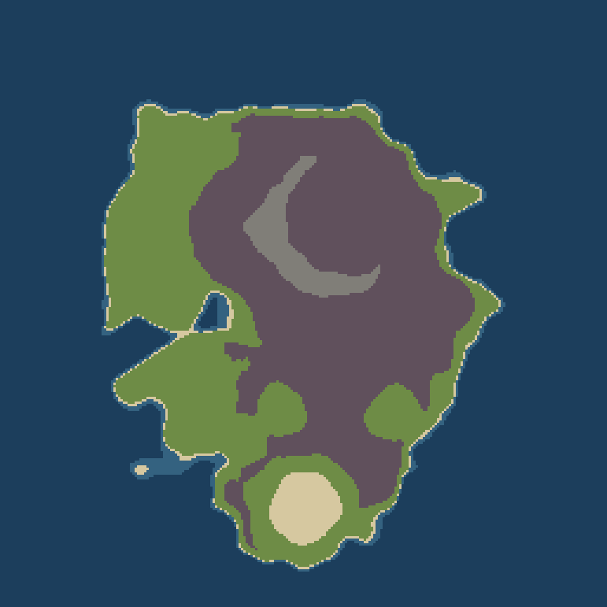

# Unreal.Soulslike

A co-op souls-like demo built in Unreal Engine 5.7: third-person combat on an isolated island in
the Outer Hebrides. Land on the beach, fight through the crofts and past the broch and the
standing stones, and take the ruined keep from the Hollow Laird. Play alone or with friends.



## What's in it

- **The island** is generated from a heightmap (`tools/generate_heightmap.py` →
  `Content/Terrain/`). It has a ragged coastline, a sea loch, low moorland and a keep in a rocky
  bowl. The open sea surrounds it, with Hebridean mist, sky and sun on top.
- **Ruins**: crofts, an Iron Age broch, a Callanish-style stone circle and avenue, the keep, and
  scattered boulders.
- **Characters**: CC0 [KayKit](https://kaylousberg.itch.io/) knight and skeletons sharing one
  rig and animation set (`SourceArt/`, credits in `SourceArt/CREDITS.md`).
- **Combat** is server-authoritative and replicated for co-op. Dodge (i-frames), block
  (stamina, guard break), parry (staggers the attacker), light and heavy attacks with readable
  wind-ups, flask heals, hit-stun, death and respawn on the beach.
- **Skeletons** see in a cone and hear you running. They grow suspicious (?), go on alert (!),
  call nearby allies, chase and attack, raise shields, and give up if you outrun their leash.
  The Hollow Laird guards the keep.

## Controls

| Action | Gamepad | Mouse / keyboard |
|---|---|---|
| Move / look | L-stick / R-stick | WASD / mouse |
| Light attack / stealth execute | X | LMB |
| Heavy attack | Y | F |
| Jump / climb-jump | A | Space |
| Dodge (let go while climbing) | B | Shift |
| Block (hold) | LB | RMB |
| Parry | LT | Q |
| Heal | RB | R |
| Shadow merge | R3 | E |

## Build and run

Requires Unreal Engine 5.7 from the Epic Launcher and Visual Studio's C++ game tools.

```powershell
./run.ps1                  # compile, import art + build the map, then play
./run.ps1 -Players 2       # co-op: a listen server plus one client on this machine
./run.ps1 -SkipContent     # recompile and play without re-importing art
```

To check a build without playing it, add `-Extra "-DemoBot -AutoShot=5 -QuitAfter=60"`. The bot
plays the game by itself, a screenshot lands in `Saved/Screenshots` every 5 seconds, and the game
exits after a minute.

## Roadmap

These have tickets in `docs/USER_STORIES.md`:
- jumping and free climbing
- stealth executions
- shadow-merging into walls
- buried ruins and the guarded loch bridge
- a C# (UnrealSharp) twin of the whole game, to compare against the C++ build
